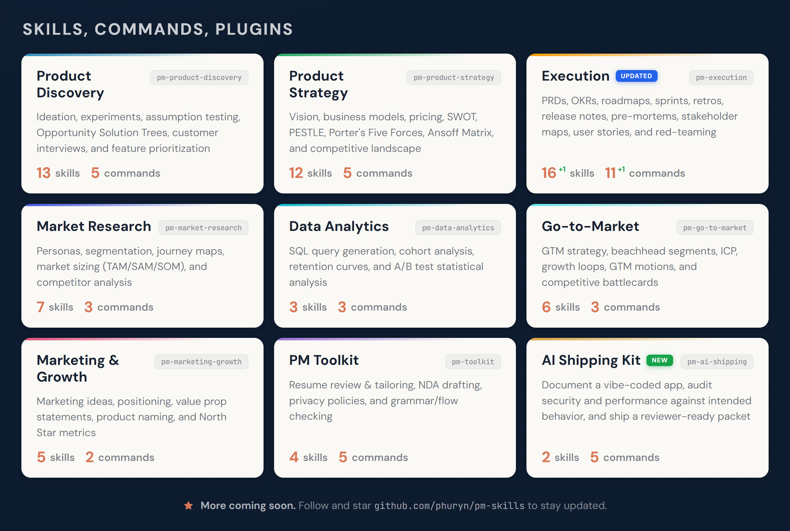
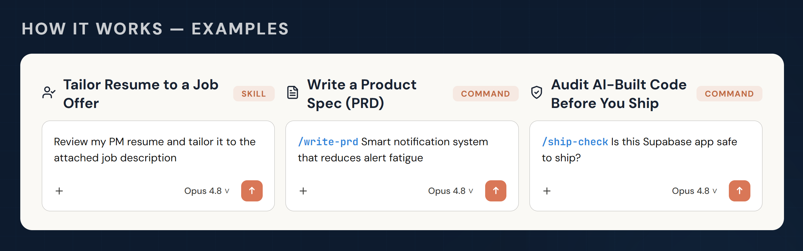
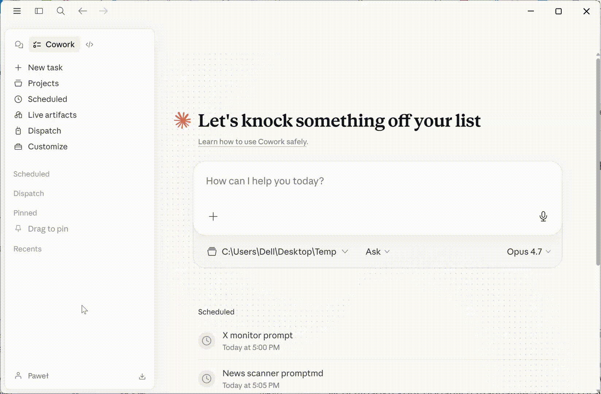
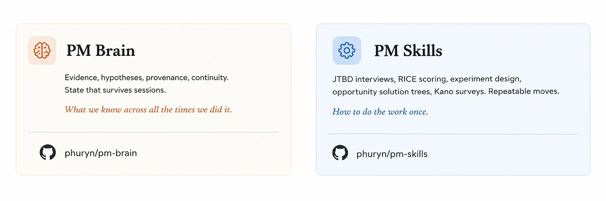

[](https://github.com/phuryn/pm-skills/blob/main/LICENSE)
[](https://github.com/phuryn/pm-skills/blob/main/CONTRIBUTING.md)
[](https://github.com/phuryn/pm-skills/actions/workflows/tests.yml)
[](https://github.com/phuryn/pm-brain)
[](https://github.com/phuryn/burnstop)
[](https://github.com/phuryn/claude-usage)

# PM Skills Marketplace：让产品决策更好的 AI 操作系统

> 69 个 PM 技能、42 条链式工作流，覆盖 9 个插件（69 PM skills and 42 chained workflows across 9 plugins）。支持 Claude Code、Cowork 等。从产品发现到战略、执行、上市、增长，以及交付由 AI 构建的代码。



为 Claude Code 与 Cowork 设计。技能可与其他 AI 助手兼容。

## 从这里开始

新想法？ → `/discover`  
需要战略上的清晰度？ → `/strategy`  
要写 PRD？ → `/write-prd`  
要规划发布？ → `/plan-launch`  
要定义指标？ → `/north-star`

如果这个项目对你有帮助，给仓库点个 ⭐。

## 为什么选择 PM Skills Marketplace？

通用 AI 只给你文字，PM Skills Marketplace 给你结构。

每个技能都编码了一套经过验证的 PM 框架——产品发现、假设映射、优先级排序、战略——并带你一步步走完。Teresa Torres、Marty Cagan 和 Alberto Savoia 的严谨方法被内建到你的日常工作流里，而不是摆在书架上。

结果是：更好的产品决策，而不只是更快的文档。

## 工作原理（技能、命令、插件）



**技能（Skills）** 是插件市场的基本构件。每个技能为 Claude 提供领域知识、分析框架，或针对某项具体 PM 任务的分步工作流。有些技能还充当可复用的基础，被多个命令共享。

当与对话相关时，技能会被自动加载——无需显式调用。如果需要（例如想让技能优先于通用知识），你可以用 `/plugin-name:skill-name` 或 `/skill-name` **强制加载技能**（前缀由 Claude 补全）。

**命令（Commands）** 是由用户触发的工作流，用 `/command-name` 调用。它们把一个或多个技能串成端到端流程。例如 `/discover` 把四个技能串在一起：brainstorm-ideas → identify-assumptions → prioritize-assumptions → brainstorm-experiments。

**插件（Plugins）** 把相关的技能与命令归入可安装的包。每个插件覆盖一个 PM 领域——产品发现、战略、执行等。安装这个插件市场，就能一次得到全部 9 个插件。

命令会使用技能。有些技能服务于多个命令。还有些技能（如 `prioritization-frameworks` 或 `opportunity-solution-tree`）是独立参考，只要相关 Claude 就会取用——不需要命令。

命令被设计成可以彼此衔接，契合 PM 的工作流。任何命令完成后，都会推荐相关的下一条命令——照着提示走即可。

## 安装

### Claude Cowork（推荐非开发者使用）

1. 打开左下角的 **Customize**
2. 进入 **Browse plugins** → **Personal** → **+**
3. 选择 **Add marketplace from GitHub**
4. 输入：`phuryn/pm-skills`

全部 9 个插件会自动安装。你既能得到命令（`/discover`、`/strategy` 等），也能得到技能。



### Claude Code (CLI)

```bash
# 第 1 步：添加插件市场
claude plugin marketplace add phuryn/pm-skills

# 第 2 步：安装各个插件
claude plugin install pm-toolkit@pm-skills
claude plugin install pm-product-strategy@pm-skills
claude plugin install pm-product-discovery@pm-skills 
claude plugin install pm-market-research@pm-skills 
claude plugin install pm-data-analytics@pm-skills
claude plugin install pm-marketing-growth@pm-skills
claude plugin install pm-go-to-market@pm-skills
claude plugin install pm-execution@pm-skills
claude plugin install pm-ai-shipping@pm-skills
```

### Codex CLI (OpenAI)

Codex 读取与 Claude Code 相同的插件市场文件，所以你可以原生安装 PM Skills——无需转换或复制文件：

```bash
# 第 1 步：添加插件市场
codex plugin marketplace add phuryn/pm-skills

# 第 2 步：安装你想要的插件
codex plugin add pm-toolkit@pm-skills
codex plugin add pm-product-strategy@pm-skills
codex plugin add pm-product-discovery@pm-skills
codex plugin add pm-market-research@pm-skills
codex plugin add pm-data-analytics@pm-skills
codex plugin add pm-marketing-growth@pm-skills
codex plugin add pm-go-to-market@pm-skills
codex plugin add pm-execution@pm-skills
codex plugin add pm-ai-shipping@pm-skills
```

**你将获得：** 每个技能（即 PM 框架）都对 Codex 可用，并可按名称调用。请安装整个插件，而不是挑单个技能——一个工作流通常依赖多个一起发布的技能。

**与 Claude Code 的不同之处：** `/slash` 命令（`/discover`、`/write-prd` 等）会被安装，但不会作为 Codex 的斜杠命令运行——Codex 插件不暴露命令。要运行工作流，只需用自然语言描述步骤，例如：

> 对 *[你的想法]* 做一次产品发现：头脑风暴选项、映射假设、给风险高的假设排优先级，然后设计实验——每一步之间先暂停。

**可选——让 Codex 把工作流转成技能。** 因为命令文件随每个已安装的插件一起发布，你可以让 Codex 把你最常用的那些转换过来：

> 阅读 pm-execution 插件里的命令文件，为我最常用的工作流创建等价的 Codex 技能。

这是尽力而为、由模型驱动的转换（某些 Claude 专有的命令语法无法转换），但它是在不离开 CLI 的情况下，在 Codex 上拿到这些引导式工作流的快捷方式。

### 其他 AI 助手（仅技能）

`skills/*/SKILL.md` 文件遵循通用技能格式，任何能读取该格式的工具都能使用。命令（`/slash-commands`）是 Claude 专有的。

| 工具 | 使用方法 | 可用内容 |
|------|-----------|------------|
| **Gemini CLI** | 把技能目录复制到 `.gemini/skills/` | 仅技能 |
| **OpenCode** | 把技能目录复制到 `.opencode/skills/` | 仅技能 |
| **Cursor** | 把技能目录复制到 `.cursor/skills/` | 仅技能 |
| **Kiro** | 把技能目录复制到 `.kiro/skills/` | 仅技能 |

```bash
# 示例：为 OpenCode 复制全部技能（项目级）
for plugin in pm-*/; do
  mkdir -p .opencode/skills/
  cp -r "$plugin/skills/"* .opencode/skills/ 2>/dev/null
done

# 示例：为 Gemini CLI 复制全部技能（全局）
for plugin in pm-*/; do
  cp -r "$plugin/skills/"* ~/.gemini/skills/ 2>/dev/null
done
```

---

## 可用插件

<details>
<summary><strong>1. pm-product-discovery</strong> — 构思、实验、假设验证、机会解决方案树、访谈 (13 skills, 5 commands)</summary>

**技能（13）：**

- `brainstorm-ideas-existing` — 面向现有产品的多视角构思（PM、设计师、工程师）
- `brainstorm-ideas-new` — 面向新产品早期发现阶段的构思
- `brainstorm-experiments-existing` — 为现有产品设计实验以验证假设
- `brainstorm-experiments-new` — 为新产品设计精益创业式预原型（Alberto Savoia）
- `identify-assumptions-existing` — 在价值、可用性、可行性、可交付性上识别高风险假设
- `identify-assumptions-new` — 跨 8 类风险（含上市策略、战略、团队）识别高风险假设
- `prioritize-assumptions` — 用影响 × 风险矩阵给假设排优先级，并给出实验建议
- `prioritize-features` — 依据影响、工作量、风险与战略契合度给功能待办排优先级
- `analyze-feature-requests` — 按主题与战略契合度分析并归类客户功能需求
- `opportunity-solution-tree` — 构建机会解决方案树（Teresa Torres）——结果 → 机会 → 解决方案 → 实验
- `interview-script` — 创建结构化客户访谈提纲，包含 JTBD 追问问题
- `summarize-interview` — 把访谈记录总结为 JTBD、满意度信号与行动项
- `metrics-dashboard` — 设计产品指标看板，含北极星指标、输入指标与告警阈值

**命令（5）：**

- `/discover` — 完整发现循环：构思 → 假设映射 → 优先级排序 → 实验设计
- `/brainstorm` — 多视角构思（`ideas|experiments` × `existing|new`）
- `/triage-requests` — 分析并给一批功能需求排优先级
- `/interview` — 准备访谈提纲或总结访谈记录（`prep|summarize`）
- `/setup-metrics` — 设计产品指标看板

**示例：**

技能：
- `我们的 AI 写作助手创意中，风险最高的假设有哪些？`
- `帮我为提升用户激活率构建一棵机会解决方案树`
- `给我们企业客户的这 12 条功能需求排个优先级 [附上 CSV]`

命令：
- `/discover 面向远程团队的 AI 会议纪要工具`
- `/brainstorm experiments existing——我们需要降低新手引导流程的流失`
- `/interview prep——我们要访谈企业采购人员，聊他们的采购流程`

</details>

<details>
<summary><strong>2. pm-product-strategy</strong> — 愿景、商业模式、定价、竞争格局 (12 skills, 5 commands)</summary>

产品战略、愿景、商业模式、定价与宏观环境分析。覆盖从愿景塑造到竞争格局扫描的完整战略工具箱。

**技能（12）：**

- `product-strategy` — 9 部分的产品战略画布（愿景 → 可防御性）
- `startup-canvas` — 创业画布，融合产品战略（9 部分）与商业模式——面向新产品，是 BMC 与精益画布的替代方案
- `product-vision` — 打造鼓舞人心、可实现且有情感共鸣的产品愿景
- `value-proposition` — 6 部分 JTBD 价值主张（Who、Why、What before、How、What after、Alternatives）
- `lean-canvas` — 面向创业公司与新产品的精益画布商业模式
- `business-model` — 含全部 9 个构件的商业模式画布
- `monetization-strategy` — 头脑风暴 3–5 种变现策略，并设计验证实验
- `pricing-strategy` — 定价模型、竞品分析、付费意愿与价格弹性
- `swot-analysis` — SWOT 分析，并给出可落地的建议
- `pestle-analysis` — 宏观环境：政治、经济、社会、技术、法律、环境
- `porters-five-forces` — 竞争力量分析（同业竞争、供应商、买方、替代品、新进入者）
- `ansoff-matrix` — 跨市场与产品的增长战略映射

**命令（5）：**

- `/strategy` — 创建一份完整的 9 部分产品战略画布
- `/business-model` — 探索商业模式（`lean|full|startup|value-prop|all`）
- `/value-proposition` — 用 6 部分 JTBD 模板设计价值主张
- `/market-scan` — 结合 SWOT + PESTLE + 波特五力 + 安索夫矩阵的宏观环境分析
- `/pricing` — 设计定价策略，包含竞品分析与实验

**示例：**

技能：
- `帮我比较精益画布、商业模式画布与创业画布，我的项目是平台型创业公司`
- `为面向非英语母语用户的 AI 写作助手设计价值主张`
- `对项目管理 SaaS 市场做一次波特五力分析`

命令：
- `/strategy 面向代理公司的 B2B 项目管理工具`
- `/business-model startup——面向非英语母语用户的 AI 写作工具`
- `/value-proposition 面向企业客户的 SaaS 新手引导工具`

</details>

<details>
<summary><strong>3. pm-execution</strong> — PRD、OKR、路线图、冲刺、复盘、发布说明、利益相关方管理 (16 skills, 11 commands)</summary>

日常产品管理：PRD、OKR、路线图、冲刺、复盘、发布说明、事前验尸、利益相关方管理、用户故事与优先级框架。

**技能（16）：**

- `create-prd` — 精简的 8 部分 PRD 模板（可按需给出更完整的规格说明）
- `brainstorm-okrs` — 与公司目标对齐的团队级 OKR
- `outcome-roadmap` — 把功能清单转化为结果导向的路线图
- `sprint-plan` — 冲刺计划：容量估算、故事选择与风险识别
- `retro` — 结构化的冲刺复盘引导
- `release-notes` — 从工单、PRD 或变更日志生成面向用户的发布说明
- `pre-mortem` — 按「老虎／纸老虎／大象」分类的风险分析
- `stakeholder-map` — 权力 × 利益矩阵，配定制化沟通计划
- `summarize-meeting` — 会议记录 → 决策 + 行动项
- `user-stories` — 遵循 3C 与 INVEST 标准的用户故事
- `job-stories` — 任务故事：当 [情境]，我想 [动机]，以便 [结果]
- `wwas` — Why-What-Acceptance 格式的产品待办项
- `test-scenarios` — 测试场景：正常路径、边界情况、错误处理
- `dummy-dataset` — 生成 CSV、JSON、SQL 或 Python 格式的逼真虚拟数据集
- `prioritization-frameworks` — 9 种优先级框架的参考指南（Opportunity Score、ICE、RICE、MoSCoW、Kano 等）
- `strategy-red-team` — 对计划进行对抗式压力测试：找出承重的关键假设，点明什么会让每个假设失效，并按最省成本的验证方式排序

**命令（11）：**

- `/write-prd` — 从功能想法或问题陈述创建 PRD
- `/plan-okrs` — 头脑风暴团队级 OKR
- `/transform-roadmap` — 把基于功能的路线图转为结果导向
- `/sprint` — 冲刺生命周期（`plan|retro|release`）
- `/pre-mortem` — 对 PRD 或发布计划做事前验尸式风险分析
- `/red-team-prd` — 对 PRD、路线图或战略做对抗式压力测试，并按最省成本的验证方式给风险最高的假设排序
- `/meeting-notes` — 把会议记录总结为结构化纪要
- `/stakeholder-map` — 梳理利益相关方并制定沟通计划
- `/write-stories` — 把功能拆成待办项（`user|job|wwa`）
- `/test-scenarios` — 从用户故事生成测试场景
- `/generate-data` — 生成逼真的虚拟数据集

**示例：**

技能：
- `面对 50 条待办，我该用哪种优先级框架？`
- `为平台迁移项目梳理我们的利益相关方`
- `Opportunity Score、ICE 和 RICE 有什么区别？`

命令：
- `/write-prd 减少告警疲劳的智能通知系统`
- `/sprint retro——这是我们上次冲刺的记录`
- `/write-stories job——把「团队看板」功能拆成任务故事`

</details>

<details>
<summary><strong>4. pm-market-research</strong> — 用户画像、用户细分、旅程地图、市场规模测算、竞品分析 (7 skills, 3 commands)</summary>

用户研究与竞品分析：用户画像、用户细分、旅程地图、市场规模测算、竞品分析与反馈分析。

**技能（7）：**

- `user-personas` — 基于研究数据创建精细的用户画像
- `market-segments` — 识别 3–5 个客户细分，含人口特征、JTBD 与产品契合度
- `user-segmentation` — 基于行为、JTBD 与需求，从反馈数据中细分用户
- `customer-journey-map` — 端到端旅程地图，含阶段、触点、情绪与痛点
- `market-sizing` — TAM、SAM、SOM，含自上而下与自下而上两种方法
- `competitor-analysis` — 竞品优势、劣势与差异化机会
- `sentiment-analysis` — 从用户反馈中做情感分析与主题提取

**命令（3）：**

- `/research-users` — 构建用户画像、细分用户并绘制客户旅程
- `/competitive-analysis` — 分析竞争格局
- `/analyze-feedback` — 从用户反馈中做情感分析与细分洞察

**示例：**

技能：
- `估算美国市场上一款 AI 代码评审工具的 TAM/SAM/SOM`
- `为我们的电商结算流程创建客户旅程地图`
- `按行为与需求细分这些问卷受访者 [附上 CSV]`

命令：
- `/research-users 我们有 12 位健身 App 用户的访谈数据`
- `/competitive-analysis Figma 在设计工具领域的竞争对手`
- `/analyze-feedback 这是 Q4 的 200 份 NPS 回复 [附上文件]`

</details>

<details>
<summary><strong>5. pm-data-analytics</strong> — SQL 生成、同期群分析、A/B 测试分析 (3 skills, 3 commands)</summary>

面向 PM 的数据分析：SQL 查询生成、同期群分析与 A/B 测试分析。

**技能（3）：**

- `sql-queries` — 从自然语言生成 SQL（BigQuery、PostgreSQL、MySQL）
- `cohort-analysis` — 留存曲线、功能采用情况与按同期群的参与度趋势
- `ab-test-analysis` — 统计显著性、样本量校验，以及上线/延长/停止的建议

**命令（3）：**

- `/write-query` — 从自然语言生成 SQL 查询
- `/analyze-cohorts` — 对用户参与度数据做同期群分析
- `/analyze-test` — 分析 A/B 测试结果

**示例：**

技能：
- `在 MDE 为 2% 的情况下，要达到 95% 置信度需要多大样本量？`
- `订阅制 App 应该追踪哪些留存指标？`

命令：
- `/write-query 给我 2025 年 Q4 按国家划分的月活用户数（BigQuery）`
- `/analyze-test 这是我们结算流程 A/B 测试的结果 [附上 CSV]`
- `/analyze-cohorts 1 月与 2 月注册用户的周留存`

</details>

<details>
<summary><strong>6. pm-go-to-market</strong> — 滩头细分市场、ICP、信息传达、增长循环、GTM 打法、竞争对战卡 (6 skills, 3 commands)</summary>

上市策略：滩头细分市场、理想客户画像、信息传达、增长循环、GTM 打法与竞争对战卡。

**技能（6）：**

- `gtm-strategy` — 完整 GTM 战略：渠道、信息传达、成功指标与发布计划
- `beachhead-segment` — 识别第一个滩头细分市场
- `ideal-customer-profile` — 含人口特征、行为、JTBD 与需求的 ICP
- `growth-loops` — 设计可持续的增长循环（飞轮）
- `gtm-motions` — 评估 GTM 打法与工具（产品驱动、销售驱动等）
- `competitive-battlecard` — 可直接用于销售的竞争对战卡，含异议处理与取胜策略

**命令（3）：**

- `/plan-launch` — 从滩头市场到发布计划的完整 GTM 战略
- `/growth-strategy` — 设计增长循环并评估 GTM 打法
- `/battlecard` — 创建竞争对战卡

**示例：**

技能：
- `面向开发者效率工具，最好的滩头细分市场是哪个？`
- `为一款带免费版层的 B2B SaaS 设计增长循环`
- `为 AI 驱动的 HR 筛选平台定义我们的 ICP`

命令：
- `/plan-launch 面向中型工程团队的 AI 代码评审工具`
- `/battlecard 我们的 CRM 对比 Salesforce，主打 SMB 市场`
- `/growth-strategy 连接自由职业者与创业公司的双边市场平台`

</details>

<details>
<summary><strong>7. pm-marketing-growth</strong> — 营销创意、定位、价值主张、命名、北极星指标 (5 skills, 2 commands)</summary>

产品营销与增长：营销创意、定位、价值主张陈述、产品命名与北极星指标。

**技能（5）：**

- `marketing-ideas` — 有创意且省钱的营销点子，含渠道与信息传达
- `positioning-ideas` — 与竞品形成差异的产品定位
- `value-prop-statements` — 面向营销、销售与新手引导的价值主张陈述
- `product-name` — 与品牌价值观和受众契合的产品命名头脑风暴
- `north-star-metric` — 北极星指标 + 输入指标，含业务类型分类

**命令（2）：**

- `/market-product` — 头脑风暴营销创意、定位、价值主张与产品命名
- `/north-star` — 定义你的北极星指标与支撑它的输入指标

**示例：**

技能：
- `头脑风暴 5 个让我们区别于 Notion 的定位角度`
- `双边市场平台适合用什么北极星指标？`
- `为我们销售团队的提案生成价值主张陈述`

命令：
- `/market-product 面向电商运营人员的 B2B 分析看板`
- `/north-star 连接自由职业者与客户的双边市场平台`

</details>

<details>
<summary><strong>8. pm-toolkit</strong> — 简历评审、法律文档、校对 (4 skills, 5 commands)</summary>

核心产品工作之外的产品经理实用工具：简历评审、法律文档与校对。

**技能（4）：**

- `review-resume` — 按 10 条最佳实践评审并调整 PM 简历（XYZ+S 公式、关键词、结构）
- `draft-nda` — 起草保密协议，条款与适用司法辖区相匹配
- `privacy-policy` — 覆盖 GDPR/CCPA 合规要求的隐私政策
- `grammar-check` — 语法、逻辑与行文检查，并给出针对性修改

**命令（5）：**

- `/review-resume` — 全面的 PM 简历评审
- `/tailor-resume` — 针对具体职位描述调整简历
- `/draft-nda` — 起草 NDA
- `/privacy-policy` — 起草隐私政策
- `/proofread` — 检查语法、逻辑与行文

**示例：**

技能：
- `按最佳实践评审我的 PM 简历 [附上 PDF]`
- `检查这份产品公告的语法与清晰度`

命令：
- `/review-resume [附上你的 PM 简历]`
- `/tailor-resume [附上简历 + 粘贴职位描述]`
- `/proofread 这是我们 Q1 投资人更新的草稿`

</details>

<details>
<summary><strong>9. pm-ai-shipping</strong> — AI Shipping Kit：为 vibe-coded 应用写文档、评审其正确性、安全性、性能缺陷、梳理测试覆盖、汇编交付包 (3 skills, 5 commands)</summary>

面向对 AI 生成代码负责的产品经理与创始人。AI 代理写代码很快，却不留 *意图* 的记录——系统应该做什么、谁能做什么、密钥放在哪里、哪些规则真正被验证过。这个工具包恢复可评审性：先为系统写文档，再审计文档所述与代码实际行为之间的差距——这是通用扫描器会漏掉的那一类 bug。

**技能（2）：**

- `shipping-artifacts` — 让 AI 构建的应用可评审的持久文档集：每个应用都需要的一套核心文档（架构、用户/权限流程、权限、变量/密钥、测试覆盖图），以及只在适用时才添加的条件文档（邮件、定时任务、SEO、内嵌代理/自动化）。它定义了每份文档必须记录什么，以及评审者如何使用它
- `intended-vs-implemented` — 找出「系统文档声称要做什么」与「代码实际做什么」之间差距的方法，并附带双方的证据引用

**命令（5）：**

- `/ship-check` — 把 vibe-coded 仓库变成评审者可直接使用的交付包：写文档、接好代理上下文、运行安全与性能审计、梳理测试覆盖，并汇编结果
- `/document-app` — 把代码库逆向成评审者与审计者所需的系统文档——一套核心文档（架构、流程、权限、变量）以及适用时的条件文档（邮件、定时任务、SEO、自动化）；`check` 不写任何文件，只报告现有文档与代码不一致之处
- `/derive-tests` — 把文档化的意图转成测试覆盖图：盘点今天已有的测试，把已存在的测试与拟议测试、未验证的缺口区分开，并推荐一套遵循仓库既定门禁策略的门禁（仓库未声明时推荐合并前绿灯的 CI 门禁）；`check` 不写任何文件，只报告覆盖图哪里已过期
- `/security-audit-static` — 静态安全审计：梳理信任边界、交叉引用文档化意图、对每条发现自我反驳，只报告有证据支撑的风险；传 git 区间或 `changes` 则只审计一次变更
- `/performance-audit-static` — 静态性能审计：找出 N+1 查询与请求瀑布、过度获取、缺失索引与缓存机会，按工作量与影响排序；传 git 区间或 `changes` 则只审计一次变更

**示例：**

技能：
- `我的 Supabase 应用需要哪些文档，别人才评审得了？`
- `这段代码的实际行为与文档所说的应该做的事，在哪里出现了分歧？`

命令：
- `/ship-check 支付服务`
- `/document-app——为这个仓库逆向生成系统文档`
- `/derive-tests——有哪些已文档化的规则还没有测试？`
- `/security-audit-static src/api`

</details>

---

## 关于

这个插件市场会随产品实践与 AI 能力一起演进。

精选技能基于以下作者的工作：

- Teresa Torres — [*Continuous Discovery Habits*](https://www.amazon.com/Continuous-Discovery-Habits-Discover-Products/dp/1736633309/)
- Marty Cagan — [*INSPIRED*](https://www.amazon.com/INSPIRED-Create-Tech-Products-Customers/dp/1119387507/) 与 [*TRANSFORMED*](https://www.amazon.com/dp/1119697336/)
- Alberto Savoia — [*The Right It*](https://www.amazon.com/Right-Many-Ideas-Yours-Succeed/dp/0062884654)
- Dan Olsen — [*The Lean Product Playbook*](https://www.amazon.com/dp/1118960874/)
- Roger L. Martin — [*Playing to Win*](https://www.amazon.com/Playing-Win-Expanded-Bonus-Articles/dp/B0F25SDYWV/)
- Ash Maurya — [*Running Lean*](https://www.amazon.com/dp/B004J4XGN6/)
- Strategyzer — [*Business Model Generation*](https://www.amazon.com/dp/0470876417/) 与 [*Value Proposition Design*](https://www.amazon.com/dp/1118968050/)
- Christina Wodtke — [*Radical Focus*](https://www.amazon.com/Radical-Focus-Achieving-Important-Objectives/dp/0996006052)
- Anthony W. Ulwick — [*Jobs to Be Done*](https://jobs-to-be-done-book.com/)
- Alistair Croll & Benjamin Yoskovitz — [*Lean Analytics*](https://www.amazon.com/Lean-Analytics-Better-Startup-Faster/dp/1449335675/)
- Sean Ellis — [*Hacking Growth*](https://www.amazon.com/Hacking-Growth-Fastest-Growing-Companies-Breakout/dp/045149721X/)
- Maja Voje — [*Go-To-Market Strategist*](https://gtmstrategist.com/)

由 Paweł Huryn 精选自 [The Product Compass Newsletter](https://www.productcompass.pm)。

## 与 PM Brain 组合使用



[PM Brain](https://github.com/phuryn/pm-brain) 是产品经理的第二大脑。就是你笔记本电脑上某个文件夹里的纯 Markdown 文件。Claude 回答前先读它们，回答后写入，每周五清扫一遍。没有向量数据库。没有云。没有代理记忆的花招。

## 贡献

见 [CONTRIBUTING.md](CONTRIBUTING.md)。

## Windows 上的已知问题

如果你的 Cowork 不稳定、无法启动虚拟机（[claude-code/issues/27010](https://github.com/anthropics/claude-code/issues/27010)），可以试试：

```powershell
$action = New-ScheduledTaskAction -Execute "powershell.exe" -Argument "-WindowStyle Hidden -Command `"if ((Get-Service CoworkVMService).Status -ne 'Running') { Start-Service CoworkVMService }`""

$trigger = New-ScheduledTaskTrigger -RepetitionInterval (New-TimeSpan -Minutes 1) -Once -At (Get-Date)

$settings = New-ScheduledTaskSettingsSet -AllowStartIfOnBatteries -DontStopIfGoingOnBatteries

Register-ScheduledTask -TaskName "CoworkVMServiceMonitor" `
  -Action $action `
  -Trigger $trigger `
  -Settings $settings `
  -RunLevel Highest `
  -User "SYSTEM"
```

它能解决 Windows 上 90% 的问题。
剩下 10%：打开 services.msc > 手动启动「Claude」服务

## 许可证

MIT——见 [LICENSE](LICENSE)。
