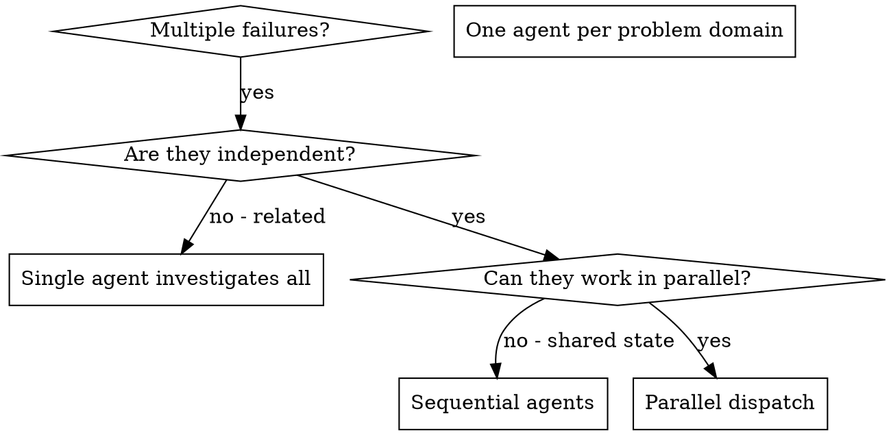

# 分派并行代理

## 概览

你把任务委派给专门化的代理，它们各自拥有隔离的上下文。通过精确设计给它们的指令和上下文，你确保它们保持专注并完成自己的任务。它们绝不应当继承你所在会话的上下文或历史——你要精确构造它们所需的一切。这同时也能为你自己保留用于协调工作的上下文。

当你面对多个互不相关的失败（不同的测试文件、不同的子系统、不同的 bug）时，逐个串行排查很浪费时间。每一次排查都是独立的，可以并行进行。

**核心原则：** 每个独立的问题域分派一个代理。让它们并发工作。

## 适用场景



**适用场景：**
- 3 个以上测试文件因不同的根因而失败
- 多个子系统各自独立地坏掉
- 每个问题都能在不依赖其他问题上下文的情况下理解
- 各次排查之间没有共享状态

**不要在以下情况使用：**
- 失败之间有关联（修好一个可能连带修好其他）
- 需要理解整个系统状态
- 代理之间会互相干扰

## 模式

### 1. 找出相互独立的领域

按坏掉的东西把失败分组：
- 文件 A 的测试：工具审批流程
- 文件 B 的测试：批量完成行为
- 文件 C 的测试：中止功能

每个领域都是独立的——修好工具审批不会影响中止相关的测试。

### 2. 创建聚焦的代理任务

每个代理拿到：
- **明确的范围：** 一个测试文件或一个子系统
- **清晰的目标：** 让这些测试通过
- **约束：** 不要改动其他代码
- **预期产出：** 你发现了什么、修了什么的总结

### 3. 并行分派

在同一条回复里发出全部三个子代理分派——它们会并行运行：

```text
子代理（general-purpose）：「修复 agent-tool-abort.test.ts 的失败」
子代理（general-purpose）：「修复 batch-completion-behavior.test.ts 的失败」
子代理（general-purpose）：「修复 tool-approval-race-conditions.test.ts 的失败」
# 三个一起并发运行。
```

一条回复里多个分派调用 = 并行执行。一条回复一个 = 串行。

### 4. 评审与整合

代理返回之后：
- 读每一份总结
- 确认修复之间不冲突
- 运行完整的测试套件
- 整合所有改动

## 代理提示词结构

好的代理提示词是：
1. **聚焦** —— 一个清晰的问题域
2. **自包含** —— 理解问题所需的全部上下文
3. **对产出有具体要求** —— 代理应该返回什么？

```markdown
修复 src/agents/agent-tool-abort.test.ts 里 3 个失败的测试：

1. 「should abort tool with partial output capture」—— 期望消息里出现 'interrupted at'
2. 「should handle mixed completed and aborted tools」—— 快速工具被中止，而不是完成
3. 「should properly track pendingToolCount」—— 期望 3 个结果却得到 0

这些是 timing/race 条件问题。你的任务：

1. 读测试文件，弄清每个测试验证什么
2. 定位根因——是时序问题还是真正的 bug？
3. 修复方式：
   - 把随意的超时换成基于事件的等待
   - 如果发现中止实现里的 bug，就修掉
   - 如果测的是变更后的行为，就调整测试期望

不要（Do NOT）简单地调大超时——要找到真正的问题。

返回：你发现了什么、修了什么，做个总结。
```

## 常见错误

**❌ 太宽泛：**「把所有测试都修好」—— 代理会迷失方向
**✅ 具体：**「修好 agent-tool-abort.test.ts」—— 范围聚焦

**❌ 没有上下文：**「修好这个竞态条件」—— 代理不知道从哪里下手
**✅ 有上下文：** 把错误信息和测试名贴进去

**❌ 没有约束：** 代理可能把所有东西都重构掉
**✅ 有约束：**「不要改动生产代码」或者「只修测试」

**❌ 产出含糊：**「修一下」—— 你不知道改了什么
**✅ 具体：**「返回根因和改动的总结」

## 不要使用的场景

**相关的失败：** 修一个可能连带修好其他——先把它们放在一起排查
**需要完整上下文：** 理解问题需要看到整个系统
**探索式调试：** 你还不知道哪里坏了
**共享状态：** 代理会互相干扰（改同一批文件、用同一批资源）

## 会话中的真实例子

**场景：** 一次大重构之后，3 个文件里共有 6 个测试失败

**失败：**
- agent-tool-abort.test.ts：3 个失败（时序问题）
- batch-completion-behavior.test.ts：2 个失败（工具没有执行）
- tool-approval-race-conditions.test.ts：1 个失败（执行计数 = 0）

**决定：** 相互独立的领域——中止逻辑、批量完成、竞态条件彼此分离

**分派：**
```
代理 1 → 修复 agent-tool-abort.test.ts
代理 2 → 修复 batch-completion-behavior.test.ts
代理 3 → 修复 tool-approval-race-conditions.test.ts
```

**结果：**
- 代理 1：把超时换成了基于事件的等待
- 代理 2：修好了事件结构 bug（threadId 放错位置）
- 代理 3：补上了等待异步工具执行完成的逻辑

**整合：** 所有修复互相独立，没有冲突，完整套件全绿

## 验证

代理返回之后：
1. **评审每份总结** —— 理解改了什么
2. **检查冲突** —— 代理有没有改到同一块代码？
3. **运行完整套件** —— 确认所有修复合在一起能工作
4. **抽查** —— 代理可能犯系统性错误
