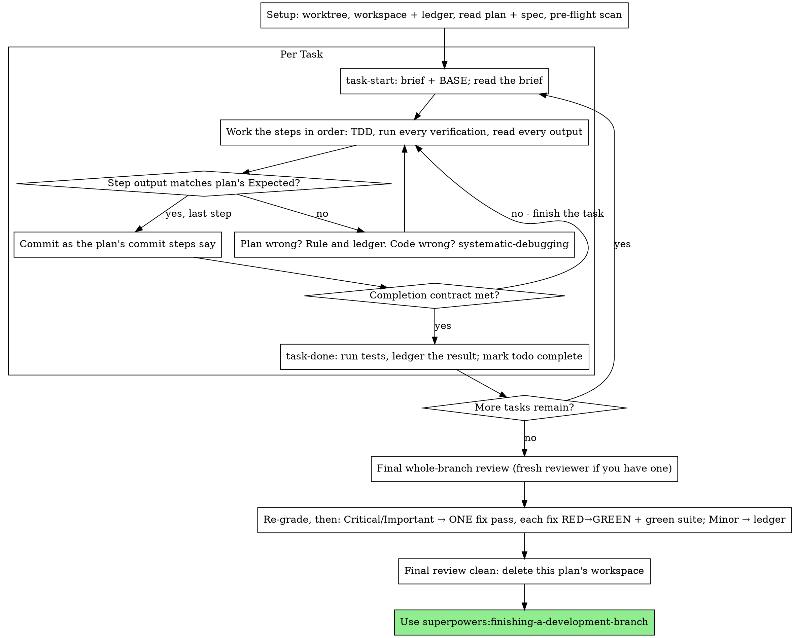

# 执行计划

在本会话里你自己一个任务一个任务地执行这份计划：每个任务没有实现者子代理，也没有评审者。到结束时，对整个分支做一次全新上下文的评审。

**为什么用内联执行：** 子代理驱动开发要为每个任务付出一个全新的实现者和一位全新的评审者，而他们各自都要从零重读代码库。内联执行只付出一个上下文（你的）加上最后一位评审者。它放弃的是每个任务的独立上下文和每个任务的第二双眼睛。这个技能用别的手段保住那两样东西换来的价值：简报就是规格，账本就是你的记忆，TDD 是每个任务的门禁，最后的评审者就是那第二双眼睛。

**核心原则：** 计划已经把思考做完了。严格照着它执行，每一步都用你亲眼看着先失败、后通过的测试来证明，并留下一份能熬过你自己遗忘的记录。

**叙述：** 两次工具调用之间，最多只叙述一行短句——账本和工具结果承担记录职责。

**连续执行：** 不要在任务之间停下来找你的搭档确认。他们选择内联执行是为了少花钱，不是为了让每个任务之后都要回答「我要继续吗？」。不停顿地把计划里的所有任务执行完。

**做裁定，不要停摆。** 冲突、歧义、计划缺陷——都由你裁定。规格是有约束力的权威，计划是针对它的论证，你的判断解决两者都回答不了的问题。把每一个决定记进账本：`Ruling: <what you decided> — <why> — <what it costs if wrong>`，然后继续。没有账本裁定就偏离计划，等于偷偷做了决定。

有四件事会让你停下来，而且只有这四件：不可逆或破坏性的操作；涉及安全的动作；本工作树之外的副作用，且按惯例应当先问一声的（合并、推送到共享分支、发布）；以及计划烂到每一条前进的路都是瞎猜。遇到这些，停下来问。

## 适用场景

- 你有一份来自 superpowers:writing-plans 的计划，并且你的搭档在交接时选择了内联执行。
- 你的宿主环境没有子代理工具（见 `../using-superpowers/references/` 里各平台的参考文档）。绝不伪造一次分派；就在这里执行计划。
- 任务大多是相互独立的——和 superpowers:subagent-driven-development 是同一个前提。

一份完全写清的计划会让内联执行变成抄写加测试：它在中档的会话模型上跑得很好，而最强模型真正物有所值的地方，是最后那次评审，本技能会另行分派它。当你的搭档选择内联执行时，把这一点告诉他们。

当你的搭档希望每个任务都有评审门禁，或者计划足够长、后面的任务会在被压缩的上下文里运行时，优先用 superpowers:subagent-driven-development。长计划上的内联执行也仍然可行——账本是让它可恢复的关键——但最后几个任务得到的你最少。

## 流程

## 准备

确保工作在隔离的工作区里进行：用 superpowers:using-git-worktrees 创建一个，或者核验现有的那个。没有你搭档明确同意，绝不在 main/master 分支上开始实现。

对话记忆熬不过上下文压缩。一个内联执行者一旦丢失进度，就会重新实现那些提交已经存在的任务——这和控制器重新分派它们是同一种失败，只是花的是你自己的上下文。把进度记在账本文件里，不能只记在 todo 里。宿主环境的 todo 是实时视图；账本才是记录。

工作区和账本与 superpowers:subagent-driven-development 共用——同一个目录、同一种格式——所以一份计划可以在中途换执行者，新的执行者会从同一份账本接着做。

- 每份计划拥有一个工作区：技能一开始就运行 `../subagent-driven-development/scripts/sdd-workspace PLAN_FILE`——它会打印这份计划被 git 忽略的目录（`<repo-root>/.superpowers/sdd/<plan-basename>/`），这是本计划所有产物的家：账本、简报、评审包。另一份计划的目录永远不归你读或写。
- 在 `<workspace>/progress.md` 检查本计划的账本。如果它的第一行写的正是你的计划文件，那么带有 `Task <N>: complete` 行的任务就是已完成——不要重做；从第一个没有该行的任务接着做。就算你的上下文已经不记得做过它们，它们的提交也存在于 git 里：压缩之后，相信账本和 `git log`，而不是你自己的回忆。如果账本第一行写的是另一份计划文件，那是别的计划的进度：别动它，新建你自己的。
- 创建账本，并把它的身份写在第一行：`# SDD ledger — plan: <plan file path>`。
- `git clean -fdx` 会摧毁工作区（它是被 git 忽略的临时目录）；如果真发生了，就从 `git log` 恢复。

把计划读一遍，记下它的上下文和全局约束，并为每个任务建一条 todo。如果计划点名了一份规格（Spec），也把它读了：规格是计划据以论证的权威，计划内部的冲突以它为准。如果计划的规格无法获取，就在账本里写一条说明——没有规格时做出的裁定都是暂时性的。

**必需的子技能：** 现在就加载 superpowers:test-driven-development，在第 1 个任务之前。它支配下面每个任务的每一步；一份步骤里已经写着「先写失败的测试」的计划，并不能让你免于读它。

在第 1 个任务之前，扫描计划，找任务之间的冲突。计划的 Interfaces 区块告诉你该看哪里：对每一个消费了更早任务产物的任务，记一行账本——两个任务、一个产出什么、另一个消费什么，以及你发现了什么。彼此不共享任何东西的任务不记行；如果一份计划的任务之间毫无共享，就只写一行 `Pre-flight: no shared interfaces`。对每行暴露出来的冲突，以规格为有约束力的权威做裁定，把裁定记在该行旁边，然后开始第 1 个任务。每个任务自身的文本会在你读它简报的时候检查，不在这里检查。

## 任务循环

你打印的每一行、每一个工具结果，都会在本次会话余下的时间里驻留在你的上下文中。把冗长的测试输出重定向到工作区里的文件，只读它的尾部；读简报，不要读整份计划。

### 1. 接下任务

- 运行本技能的 `scripts/task-start PLAN_FILE N`。它一次调用就打印出简报路径和 BASE（本任务的范围从哪个提交切出来）。每个任务都要读简报，包括你在准备阶段已经记住的那些：你记住的是摘要，简报里才有确切的取值、签名和测试用例。
- 把该任务的 todo 标记为 in_progress。

每一次工具调用都是一轮，会重新读一遍你的整个上下文。记录性的工作要顺带完成——把账本追加和提交放在同一次调用里，绝不让它单独占一次调用。

### 2. 执行步骤

计划里的步骤已经是红-绿顺序；在准备阶段加载的 superpowers:test-driven-development 之下，按这个顺序执行它们。测试步骤的代码要先写、先跑。看着它失败是一个步骤，不是走过场——一个在实现还不存在时就通过的测试，是关于这个测试的一条发现。

每个运行命令的步骤都有一行 `Expected:`。运行命令，读它的输出，然后比对。会有三种结果：

- **匹配。** 下一步。
- **代码错了。** 用 superpowers:systematic-debugging。找到原因；绝不为了步骤输出对上而给症状打补丁。
- **计划错了**——某个步骤与规格矛盾、更早任务的接口与本任务消费的东西对不上、某条命令根本不可能跑通。以「满足规格的最小改动」为原则做裁定，记进账本：`Task <N>: Ruling: <finding> — <what you decided and why>`，然后继续。裁定是被携带的，不是靠记忆的：后续碰到同一接口的任务会从账本里读它。

按计划里的提交步骤提交。一个任务跨几个提交没问题；BASE 是评审范围切出来的地方，绝不是 `HEAD~1`。

### 3. 完成契约

在一个任务落下账本行之前，以下各项都必须为真，并且证据就在本次会话里——不是靠「diff 看起来对」推断出来的：

- 简报点名的每个测试都存在，并且在本任务中跑过，而你读过输出。
- 本任务最后那次测试运行通过了——`task-done` 就是那次运行，它把命令和结果写进账本行。
- 简报里的每一行 `Expected:` 都和真实输出比对过。
- 每一处对简报的偏离，账本里都有一行 `Ruling:`。

**必需的子技能：** superpowers:verification-before-completion 支配这个声明。任何一项缺失，任务就没有完成：把它做完。

### 4. 完成任务

运行本技能的 `scripts/task-done PLAN_FILE N BASE -- <test command>`，测试命令用简报为整个任务指定的那个。它会跑测试，把完整输出留在工作区，打印尾部，并且——只有在测试通过时——才把完成行追加到账本：

`Task <N>: complete (commits <base7>..<head7>, tests: <command> → <result>)`

失败的一次运行什么都不记录；任务不算完成。当它记录成功时，把 todo 标记为完成，然后接下一个任务。

## 最终评审

运行 `../subagent-driven-development/scripts/review-package PLAN_FILE MERGE_BASE HEAD`（MERGE_BASE = 分支起始的那个提交，例如 `git merge-base main HEAD`），并依据它打印出的文件进行评审。

**有子代理工具时：** 把评审者分派到可用的最强模型上——整分支评审是一项判断任务——使用 superpowers:requesting-code-review 的 [code-reviewer.md](../requesting-code-review/code-reviewer.md)，带上评审包路径、计划与规格路径、计划的 Review Focus 一节（如果有，逐字照搬：计划里的测试未覆盖的输入类别和失效模式——评审者要逐条刻意检查），以及指向账本中 `Ruling:` 行的指针，好让它权衡你做过的裁定。要显式指定模型；省略模型会继承会话的模型，那未必是最强的那一个。这是整轮运行买到的唯一一个全新上下文。不要跳过它，也不要用你自己读 diff 来代替它。

**没有子代理工具时：** 读 code-reviewer.md，并在最后一个任务的账本行之后，作为单独一遍，自己对着评审包做那次评审。把 `Final review: self-review (no subagent tool)` 写进账本，并在最终消息里说明：作者自审比一位全新评审者弱，是否足够，由你的搭档在合并前决定。

在对任何发现动手之前，先把它们排序。评审者给的严重度标签是建议；门禁由你把。它的「Declined to judge」列表也归你：那里每一行都是你要做出并记进账本的裁定，和计划冲突完全一样——`Final: Ruling: <behavior the reviewer set aside> —
<what a reasonable person using this software gets, and why that stands
or why it is now a finding> — <cost if wrong>`。先按实际影响重新定级：规格是愿景文档，一条发现的等级是「如果它上线，一个用这个软件的正常人会得到什么」，而不是「规格是否点名了触发它的那个输入」——一位因为规格沉默就把发现定为 Minor 的评审者，评的是规格，不是影响。然后：

- **Critical 和 Important** 进入修复轮。
- **Minor** 写进账本：`Final: minor (deferred): <one-liner>`，并写进最终消息的「Deferred minors」下。Minor 绝不进入修复轮，也绝不变成裁定——裁定是对冲突的决定，不是「我拒绝了一条润色建议」的备注。

Critical 和 Important 级的发现由你自己修——这里你就是实现者——只做一轮。每个修复都用 TDD 验证，而不是靠第二位评审者：写出能复现该发现的测试，看着它失败，让它通过，然后跑完整的测试套件。把每个修复记进账本：`Final: fixed <finding> — <test name> RED→GREEN, suite <N>/<N>`。没有先失败过的测试的修复不算验证；这一轮之后套件不绿，就说明这一轮还没结束。不要分派复审：那只会重读一个 diff，而它对应的测试已经回答了「已解决」、套件运行已经回答了「没弄坏别的」。

你决定不修的发现是一条裁定——`Final: Ruling: <finding> —
<why the code stands> — <cost if wrong>`——并且会进入给搭档的裁定列表。没有第二轮修复。

## 收尾

在删除任何东西之前，把所有含 `Ruling:` 的账本行收集到最终消息的「Rulings I made」下，按你做决定的顺序排列，每条都说明万一错了要付出什么；再把所有 `minor (deferred)` 行收集到「Deferred minors」下。两份清单都必须穷尽。你替搭档做出的决定——以及你选择不处理的发现——只有通过最终消息才能抵达他们。

当最终评审干净、它的修复都已提交后，删除本计划的工作区目录——现在 git 历史就是记录。同级目录属于别的计划；别去动它们。

使用 superpowers:finishing-a-development-branch。

## 常见的自我合理化

| 借口 | 现实 |
|--------|---------|
| 「我记得任务 N 说的是什么」 | 你记得的是摘要。简报里才有确切的取值。去读它。 |
| 「计划里的代码是对的，跳过看测试失败吧」 | 你没看着它失败过的测试什么也证明不了。那只是一个步骤。去跑它。 |
| 「我到最后再跑完整套件，不用每个步骤都跑」 | 逐步运行才能让你知道是哪一步弄坏的。任务结束那次运行是契约，不是替代品。 |
| 「计划这里错了，我直接做对的事就行」 | 做对的事，并把裁定记进账本。没记账的偏离就是偷偷做的决定。 |
| 「等做完几个任务我再补账本行」 | 上下文压缩不会等一个方便的时刻。每个任务一行，和提交同一条消息。 |
| 「下一个任务之前让我确认一下」 | 他们选内联是为了少花钱。进度提示花的是他们的时间。只有那四种情况才会让你停下来。 |
| 「我自己仔细读过 diff 了，最终评审者是多余的」 | 同一个作者，同样的盲区。评审者是这轮运行唯一买到的全新上下文。 |
| 「测试应该会过，改动很琐碎」 | 「应该」不是证据。契约要求命令及其输出。 |
| 「子代理又慢又贵，那最终评审也跳过吧」 | 内联已经去掉了每个任务的评审者。对整条分支做一次评审是下限，不是上限。 |
| 「评审者说是 Minor，那就是 Minor」 | 那个标签评的是规格的沉默。要评的是人实际得到什么。重新定级，再设门禁。 |
| 「修复很明显，不用先写失败的测试」 | 失败的测试是唯一能证明这条发现真实、且现在已经消失的东西。没有它，你只有一份 diff 和一个希望。 |
| 「既然都动手了，Minor 我也顺手修了」 | 你每修一个 Minor，就是一次测试、一次修复、一次套件运行，而你的搭档并没有要求。记账；由你的搭档决定。 |
