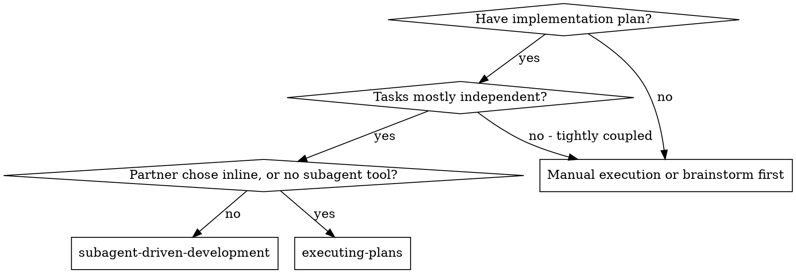
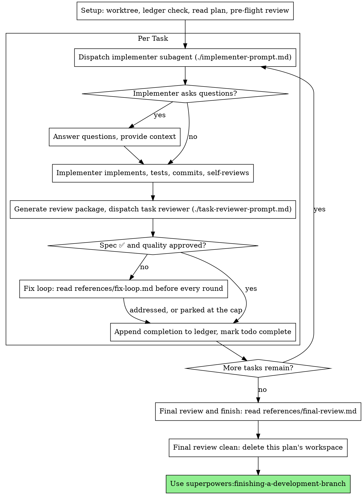

# 子代理驱动开发

通过为每个任务分派一个全新的实现者子代理、每项任务之后做一次任务评审（规格符合性 + 代码质量），并在最后做一次覆盖整个分支的全面评审，来执行计划。

**为什么用子代理：** 你把任务委派给拥有隔离上下文的专用代理。通过精确构造它们的指令与上下文，你确保它们保持专注、把任务做成功。它们绝不应该继承你所在会话的上下文或历史——你要构造的正是它们所需的一切。这也为你自己保住了用于协调工作的上下文。

**核心原则：** 每个任务一个全新子代理 + 任务评审（规格 + 质量）+ 最后的全面评审 = 高质量、快速迭代

**旁白：** 在工具调用之间，最多只叙述一行短句——记录由进度账本和工具结果承载。

**连续执行：** 不要在任务之间停下来与你的搭档确认。不中断地执行计划中的所有任务。停下来的唯一理由就是下面列出的四种情况，或者所有任务已完成。「要我继续吗？」这类询问和进度汇报都在浪费他们的时间——他们要求你执行计划，那就执行。

**做裁定，而不是卡住。** 一个正在运行的计划不会等人类。冲突、歧义、计划缺陷、一个你本来会申请突破的上限——都由你自己决定。规格（spec）是约束性权威，计划是对它的论证，而你的判断解决两者都答不出的部分。把每个决定记入进度账本：`Ruling: <what you decided> — <why> — <what it costs if wrong>`，然后继续。错误裁定换来的是你的搭档看得见、也能撤销的返工；而一个卡在问题上停摆的会话，消耗的是他们的一整天，还什么都没换回来。

有四件事会让你停下，而且只有这四件：不可逆或破坏性操作；安全敏感的动作；工作树之外、按惯例应先询问的副作用（一次合并、向共享分支推送、一次发布）；以及一个坏到每条前进路径都只是猜测的计划。遇到这些，停下来问。

## 适用场景

**与执行计划（内联）对比：**
- 每个任务一个全新子代理（没有上下文污染），而不是用一个上下文做所有任务
- 每个任务后都评审（规格符合性 + 代码质量），而不是只在最后评审
- 代价是每个任务、每次评审都要一个新上下文；内联方式消耗一个上下文加一个最终评审者
- 两者都在本会话中运行，共用同一个计划工作区与进度账本，且绝不在任务之间暂停

## 流程

## 准备工作

确保工作在隔离的工作区里进行：使用 superpowers:using-git-worktrees 创建一个，或确认已有的那个。未经你的搭档明确同意，绝不在 main/master 分支上开始实现。

对话记忆熬不过上下文压缩。在真实会话中，迷失了位置的控制器曾把整段已完成的任务序列重新分派——这是观察到的最昂贵的一类失败。把进度记录在进度账本文件里，而不只是待办清单里。

- 每个计划拥有一个工作区：技能开始时，运行本技能的 `bash scripts/sdd-workspace PLAN_FILE` ——它会打印该计划的、被 git 忽略的目录（位于 `<repo-root>/.superpowers/sdd/` 下），本计划的所有产物都安放在那里：进度账本、任务简报、报告、评审包。另一个计划的目录，永远不该由你读写。
- 在 `<workspace>/progress.md` 检查本计划的进度账本。如果它存在，先读 [references/resuming.md](references/resuming.md)，再干别的：它会说明这是谁的账本、从哪里继续。
- 创建账本，第一行写明它的身份：`# SDD ledger — plan: <plan file path>`。
- 进度账本是你的恢复地图：它点名的提交在 git 里确实存在，即便你的上下文已经不再记得创建过它们。上下文压缩之后，信任账本和 `git log`，而不是你自己的记忆。
- `git clean -fdx` 会毁掉工作区（它是被 git 忽略的临时目录）；如果真发生了，从 `git log` 恢复。

通读一遍计划，记下它的上下文与全局约束（Global Constraints），并为每个任务建一条待办。如果计划指定了规格（Spec），也读它：规格是计划据以论证的权威，计划内部的冲突要对着规格来裁定。对找不到可用规格的计划，在进度账本里写一条说明——在没有规格的情况下做出的裁定都是暂时性的。

在分派任务 1 之前，读 [references/preflight.md](references/preflight.md) 并运行它描述的冲突扫描。它的表格与裁定都写进账本。

## 模型选择

为每个角色选用能胜任的最弱模型，以节省成本并提高速度。

**机械性实现任务**（孤立函数、清晰的规格、1-2 个文件）：使用快速、便宜的模型。计划写得好时，大多数实现任务都是机械性的。

**集成与判断类任务**（多文件协调、模式匹配、调试）：使用标准模型。

**架构与设计任务**：使用可用的最强模型。最后覆盖整个分支的评审就属于这一类——用可用的最强模型来分派，而不是会话默认模型。

**评审任务**：用同样的判断标准选模型，按其 diff 的规模、复杂度与风险来伸缩。一个小而机械的 diff 不需要最强模型；一处微妙的并发改动则需要。对小修复 diff 的定范围复审，用便宜到中档的层级。

**修复循环的升级（第 4-5 轮）**：使用比卡住的那个实现者至少高一档的模型。

**分派子代理时始终显式指定模型。** 省略模型会继承你所在会话的模型——往往是最强也最贵的那个——这会悄无声息地让本节失效。

**轮次数比 token 单价更重要。** 实际耗时与上下文成本随子代理执行的轮数增长，而最便宜的模型在多步工作上常常要花 2-3 倍的轮数——总体反而更贵。把中档模型作为评审者的下限，也作为依据文字描述工作的实现者的下限。当任务的计划文本里已包含要写的完整代码时，实现就只是转录加测试：这种实现者用最便宜的层级。单文件的机械性修复也用最便宜的层级。

**任务复杂度信号（实现任务）：**
- 触及 1-2 个文件且有完整规格 → 便宜模型
- 触及多个文件且有集成关切 → 标准模型
- 需要设计判断，或需要广泛理解代码库 → 最强模型

## 任务循环

**小而同类的工作：** 当计划列出若干跨文件、同类的小改动时，在分派它们之前先读 [references/batching.md](references/batching.md)。

你粘贴进分派提示词的一切——以及子代理打印回来的一切——都会在本次会话余下的时间里驻留在你的上下文中，并在之后每一轮被重新读取。把产物以文件形式交接过去。

**等待已分派的子代理：** 绝不要用很短的超时去轮询等待接口，也绝不要一直挂在一次无声、无期限的等待里。当你还有本地工作——更新进度账本、打包下一次评审、读报告——就继续干；子代理的结果会自己回来。当你确实空闲时，分几段有边界的时长来等待（平台允许的话，五到十分钟），每段之间发一行状态，并核对还在跑的子代理：把它们列出来，追查那些已经结束却没有汇报的。有边界的等待几乎保住了长等待的全部效率，同时保证一个卡住或丢失的子代理会在几分钟内被发现，而不是等到会话结束。

### 1. 分派实现者

在分派之前记下 BASE（`git rev-parse HEAD`）——评审包与修复轮次的 diff 需要它。

- **任务简报：** 分派实现者之前，运行本技能的 `bash scripts/task-brief PLAN_FILE N` ——它把任务的完整文本抽取到一个唯一命名的文件，并打印路径。这样编排你的分派，让简报始终是需求的唯一来源。你的分派里应包含：(1) 一行说明本任务在项目中的位置；(2) 简报路径，并写明「先读这个——它就是你的需求，里面的确切值要照原样使用」；(3) 简报无从知晓的、来自先前任务的接口与决定；(4) 你对简报中注意到的任何歧义的处理结果；(5) 报告文件路径与报告契约。确切值（数字、魔法字符串、签名、测试用例）只出现在简报里。绝不要让子代理去读整个计划文件。
- **报告文件：** 实现者的报告文件按简报命名（简报 `…/task-N-brief.md` → 报告 `…/task-N-report.md`），并把路径放进分派提示词。实现者把完整报告写在那里，只返回状态、提交、一行测试摘要与顾虑。
- 分派提示词描述的是一个任务，而不是会话的历史。不要把累积的先前任务摘要（「任务 1-3 之后的状态」）粘进后续分派——真实会话里有一次分派达到 42k 字符，其中 99% 是粘贴的历史。一个全新的子代理需要它的任务、它触及的接口以及全局约束。别的什么都不需要。
- 分派里带着「不用子代理」的契约（它在实现者模板里）：实现者绝不分派子代理——不派帮手，也绝不派评审者。评审由你在报告之后送达。在真实会话中，工作者派出的每个评审者都在重复控制器本来就要分派的任务评审——每个任务白多占一个评审席。
- 如果先前某个任务在你这次任务触及的区域搁置了一条发现项，就在分派里带上指向那条账本记录的指针。
- 从分派结果里记下实现者的代理身份——修复循环的第 1-3 轮要恢复这个代理。
- 绝不并行分派多个实现子代理（会冲突）。

模板：[implementer-prompt.md](implementer-prompt.md)

### 2. 处理报告

实现者子代理会报告四种状态之一。分别恰当处理：

**DONE：** 生成评审包（`bash scripts/review-package PLAN_FILE BASE HEAD`，从本技能目录运行——它会打印它写出的唯一文件路径；BASE 是你在分派实现者之前记下的那个提交——绝不要用 `HEAD~1`，那会静默丢掉多提交任务中除最后一个之外的所有提交），然后用打印出的路径分派任务评审者。

**其他任何状态**（DONE_WITH_CONCERNS、NEEDS_CONTEXT、BLOCKED）：读 [references/handling-reports.md](references/handling-reports.md) 并照做，每次收到都要照做。

如果实现者提出问题——无论开始时还是任务中途——清楚、完整地回答，需要时补充上下文，不要催着它进入实现。

### 3. 评审任务

逐任务评审是任务范围的门禁。全面评审只发生一次，在最终的分支级评审。绝不跳过任务评审，也绝不接受缺少任一裁决的报告——规格符合性和任务质量两者都必须有。实现者的自审绝不替代任务评审；两者都需要。

- 把评审者的 diff 以文件形式交给它：运行本技能的 `bash scripts/review-package PLAN_FILE BASE HEAD`，把它打印出的文件路径交给评审者（或者，在没有 bash 时：对该区间运行 `git log --oneline`、`git diff --stat` 和 `git diff -U10`，重定向到一个唯一命名的文件里）。输出永远不进入你自己的上下文，评审者一次 Read 就能看到提交列表、统计摘要和带上下文的完整 diff。使用你在分派实现者之前记下的 BASE——绝不要用 `HEAD~1`，它会静默截断多提交任务。绝不在没有 diff 文件的情况下分派任务评审者。
- **评审者的输入：** 任务评审者拿到三个路径——同一个简报文件、报告文件和评审包——外加约束该任务的全局约束。
- 你交给评审者的全局约束块，就是它的注意力透镜。把计划「全局约束」一节或规格里的约束性要求逐字抄进去：确切的值、确切的格式，以及明确写出的组件间关系（「与 X 相同的布局」「与 Y 匹配」）。评审者的模板里已经带了流程规则（YAGNI、测试卫生、评审方法）——约束块是给**本**项目规格所要求的东西。
- 不要在没有具体、任务相关理由的情况下，加入「检查所有用法」「如果有用就跑竞态测试」这类开放式指令
- 不要让评审者重跑实现者已经在同一份代码上跑过的测试——实现者的报告承载着测试证据
- 不要替评审者预判发现项——绝不要指示评审者忽略某个问题或不要标记它。如果你认为某条发现项会是误报，就让评审者提出来，在评审循环里裁定。如果你正在写的提示词里出现「不要标记」「不要把 X 当作缺陷」「最多只能算 Minor」「计划选择了」这类说法——停下：你在预判，通常是为了给自己省掉一轮评审。
如果评审者报告「⚠️ 无法从 diff 验证」的事项，在把任务标记为完成之前读 [references/cannot-verify.md](references/cannot-verify.md)。

模板：[task-reviewer-prompt.md](task-reviewer-prompt.md)

### 4. 修复循环

当评审报告规格 ❌、任何 Critical 或 Important 发现项，或者一个你已确认为真实缺口的 ⚠️ 事项时，循环被触发。

触发时，读 [references/fix-loop.md](references/fix-loop.md) 并照做。每一轮之前都要再读一遍，即便你本次会话早先读过：里面写着轮数上限、断路器，以及每轮要写的那行账本记录，而你对它的记忆熬不过上下文压缩。

### 5. 完成任务

当评审干净地返回——或者每条未结发现项都在上限处连同裁定一起搁置后——在和你其他记账动作同一条消息里，把完成行追加到账本：

- `Task <N>: complete (commits <base7>..<head7>, review clean)`
- `Task <N>: complete (commits <base7>..<head7>, <K> parked)` ——在断路器被触发之后

然后把待办标记为完成，继续往前走。当评审还有未结的 Critical/Important 问题，既没修掉也没在上限处搁置并附裁定时，绝不进入下一个任务。

## 最终评审

当每个任务都完成时，读 [references/final-review.md](references/final-review.md) 并照做。它涵盖分支级评审、那唯一一波修复，以及你如何收尾。

## 常见自我合理化

| 借口 | 现实 |
|--------|---------|
| 「规格符合性上差不多就行」 | 评审者发现了规格缺口 = 没完成。修掉，或者触到上限去裁定——只有这两个出口。 |
| 「我自己修吧，分派太麻烦」 | 控制器亲手修复会污染你的上下文，还会跳过评审。恢复实现者。 |
| 「再来一轮就会收敛」 | 过了上限，轮次不会收敛——失败是结构性的。去裁定并分流。 |
| 「反正评审者总能挑出点新东西」 | 定范围复审只核实修复；它们不能到处乱逛。未改动代码上的新发现项记入账本，不进循环。 |
| 「这条发现项明显是错的，我丢掉就行」 | 你只在上限处裁定，而且每条裁定都是一条账本记录。静默丢弃是被禁止的。 |
| 「修复很小，跳过复审吧」 | 未评审的修复正是回归落地的方式。每一轮都以一次定范围复审收尾。 |
| 「评审拖慢了循环」 | 没有评审的循环只是未经核实的空转。评审是循环的刹车和方向盘。 |
| 「账本记账是额外开销」 | 账本是熬过上下文压缩的东西。没有账本的控制器曾把整段已完成的任务序列重新分派。 |
| 「实现者自己派了评审者——白得的额外保障」 | 那是在重复一个评审同一份 diff 的席位；任务评审才是门禁。工作者派出的评审者是要标记的缺陷，不是严谨。 |
