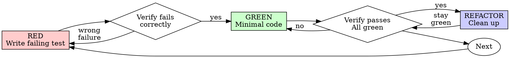

# 测试驱动开发（TDD）

## 概览

先写测试。看着它失败。写最少的代码让它通过。

**核心原则：** 如果你没有亲眼看到测试失败，你就不知道它测的是不是正确的东西。

**违反规则的字面要求，就是违反规则的精神。**

## 适用场景

**始终：**
- 新功能
- 缺陷修复
- 重构
- 行为变更

**例外（先问你的搭档）：**
- 一次性的原型
- 生成的代码
- 配置文件

想着「就这一次跳过 TDD」？停下来。那是自我合理化。

## 铁律

```
NO PRODUCTION CODE WITHOUT A FAILING TEST FIRST（没有失败的测试，就绝不写生产代码）
```

先写代码再写测试？删掉它。重新开始。

**没有例外：**
- 不要把它留作「参考」
- 不要在写测试时「改造」它
- 不要看它
- 删除就是删除

从测试开始全新实现。就这样。

## 红-绿-重构



### 红 —— 写一个会失败的测试

写一个最小的测试，展示应该发生什么。

<Good>
```typescript
test('retries failed operations 3 times', async () => {
  let attempts = 0;
  const operation = () => {
    attempts++;
    if (attempts < 3) throw new Error('fail');
    return 'success';
  };

  const result = await retryOperation(operation);

  expect(result).toBe('success');
  expect(attempts).toBe(3);
});
```
命名清晰、测真实行为、只做一件事
</Good>

<Bad>
```typescript
test('retry works', async () => {
  const mock = jest.fn()
    .mockRejectedValueOnce(new Error())
    .mockRejectedValueOnce(new Error())
    .mockResolvedValueOnce('success');
  await retryOperation(mock);
  expect(mock).toHaveBeenCalledTimes(3);
});
```
命名含糊，测的是 mock 而不是代码
</Bad>

**要求：**
- 一个行为
- 清晰的名称
- 真实代码（不到万不得已不用 mock）

### 验证红 —— 看着它失败

**强制要求。绝不跳过。**

```bash
npm test path/to/test.test.ts
```

确认：
- 测试失败（而不是报错）
- 失败信息符合预期
- 失败原因是功能缺失（而不是拼写错误）

**测试通过了？** 你测的是已有行为。修测试。

**测试报错了？** 修掉错误，重新运行，直到它正确地失败。

### 绿 —— 最少代码

写最简单的代码让测试通过。

<Good>
```typescript
async function retryOperation<T>(fn: () => Promise<T>): Promise<T> {
  for (let i = 0; i < 3; i++) {
    try {
      return await fn();
    } catch (e) {
      if (i === 2) throw e;
    }
  }
  throw new Error('unreachable');
}
```
刚刚够通过
</Good>

<Bad>
```typescript
async function retryOperation<T>(
  fn: () => Promise<T>,
  options?: {
    maxRetries?: number;
    backoff?: 'linear' | 'exponential';
    onRetry?: (attempt: number) => void;
  }
): Promise<T> {
  // YAGNI
}
```
过度设计
</Bad>

不要添加功能、不要重构其他代码、不要做超出测试的「改进」。

### 验证绿 —— 看着它通过

**强制要求。**

```bash
npm test path/to/test.test.ts
```

确认：
- 测试通过
- 其他测试仍然通过
- 输出干净（没有错误、警告）

**测试失败？** 修代码，不是修测试。

**其他测试失败？** 立刻修。

**「其他测试」指的是项目的测试套件，而不只是你自己的文件。** 你写的那一个测试跑绿，不等于整个套件是绿的。在把改动称为完成之前，运行项目的测试命令（就是 `pytest`、`npm test`、`cargo test`——仓库用什么就用什么），即使你的任务只点名了一个测试文件。任务里的范围说明约束的是交付物，不是你的验证。那次运行暴露出的任何失败——包括不是你造成的——都要在报告里点名列出；你亲眼看着它滚过屏幕却只字不提的红色测试，就是靠隐瞒伪造出来的报告。

### 重构 —— 清理

只在绿了之后：
- 消除重复
- 改进命名
- 抽取辅助函数

保持测试为绿。不要添加行为。

### 重复

为下一个功能写下一个失败的测试。

## 好的测试

| 质量 | 好 | 坏 |
|---------|------|-----|
| **最小** | 只做一件事。名字里有「和」？拆开。 | `test('validates email and domain and whitespace')` |
| **清晰** | 名字描述行为 | `test('test1')` |
| **体现意图** | 展示期望的 API | 掩盖代码应该做什么 |

在编写或修改任何测试时，阅读 [writing-good-tests.md](writing-good-tests.md)，了解让测试保持诚实的规则：
- 在写测试之前，先说出会让该测试失败的生产代码改动
- 断言真实行为，绝不断言 mock 行为
- 只给测试用的代码放在测试工具里，不要进生产类
- 在 mock 一个依赖之前，先理解它的副作用

## 常见的自我合理化

| 借口 | 现实 |
|--------|---------|
| 「太简单了，不用测」 | 简单的代码也会坏。写个测试只要 30 秒。 |
| 「我之后补测试」 | 后写的测试会立刻通过——而这不证明任何事。它们可能测错了对象、测实现而不是行为，或者漏掉了你忘记的边界情况。你从没看它失败过，所以从未证明它能抓到那个 bug。测试先行强制制造这次失败。 |
| 「后补测试也能达到同样目标（重在精神而非仪式）」 | 后写的测试回答「这段代码做了什么」；先写的测试回答「这段代码应该做什么」。后写的测试会被你已经写好的代码带偏——你验证的是你记得的情况，而不是你本会发现的那些情况。有覆盖率，却没有证据证明测试有效。 |
| 「我已经手工测过了」 | 手工测试是临时的：没有覆盖范围的记录，代码变更后无法重跑，压力下容易忘记用例。「我试的时候是好的」≠ 全面。自动化测试每次都按同样的方式运行。 |
| 「删掉已经花掉的 X 小时太浪费」 | 沉没成本谬误——那段时间反正已经花掉了。真正的选择是：用 TDD 重写（高置信度），还是保留它、事后补测试（低置信度、很可能有 bug）。留着你无法信任的代码才是浪费。 |
| 「留作参考，先写测试」 | 你会去改造它。那就是事后测试。删除就是删除。 |
| 「我需要先探索一下」 | 可以。把探索结果扔掉，从 TDD 开始。 |
| 「测试难写 = 设计不清晰」 | 听测试的。难测 = 难用。 |
| 「TDD 会拖慢我」 | TDD 才是务实的路径：在提交前抓住 bug、防止回归、让你敢于重构。「务实」的捷径意味着在生产环境里调试——更慢，不是更快。 |
| 「手工测试更快」 | 手工测试证明不了边界情况。每次改动你都要重测一遍。 |
| 「现有代码没有测试」 | 你正在改进它。为现有代码补上测试。 |

## 危险信号 —— 停下来，重新开始

- 先写代码后写测试
- 实现之后才写测试
- 测试立刻通过
- 说不清测试为什么失败
- 测试是「以后」补的
- 用「就这一次」来自我合理化
- 「我已经手工测过了」
- 「后补测试也能达到同样的目的」
- 「重在精神，不在仪式」
- 「留作参考」或「改造现有代码」
- 「已经花了 X 小时，删掉太浪费」
- 「TDD 是教条，我这是务实」
- 「这次不一样，因为……」

**以上任何一条都意味着：删掉代码。用 TDD 重新开始。**

## 示例：缺陷修复

**Bug：** 空的 email 也被接受了

**红**
```typescript
test('rejects empty email', async () => {
  const result = await submitForm({ email: '' });
  expect(result.error).toBe('Email required');
});
```

**验证红**
```bash
$ npm test
FAIL: expected 'Email required', got undefined
```

**绿**
```typescript
function submitForm(data: FormData) {
  if (!data.email?.trim()) {
    return { error: 'Email required' };
  }
  // ...
}
```

**验证绿**
```bash
$ npm test
PASS
```

**重构**
如有需要，把多个字段的校验抽取出来。

## 验证检查清单

在把工作标记为完成之前：

- [ ] 每个新函数/方法都有测试
- [ ] 在实现前亲眼看到每个测试失败
- [ ] 每个测试都因预期原因失败（功能缺失，而不是拼写错误）
- [ ] 写了最少的代码让每个测试通过
- [ ] 所有测试通过
- [ ] 输出干净（没有错误、警告）
- [ ] 测试使用真实代码（mock 仅在无法避免时使用）
- [ ] 覆盖了边界情况和错误

不能勾满所有框？你跳过了 TDD。重新开始。

## 卡住的时候

| 问题 | 解法 |
|---------|----------|
| 不知道怎么测 | 先写出期望的 API。先写断言。问你的搭档。 |
| 测试太复杂 | 设计太复杂。简化接口。 |
| 什么都得 mock | 代码耦合太重。使用依赖注入。 |
| 测试搭建工作量巨大 | 抽取辅助函数。还是复杂？简化设计。 |

## 与调试的配合

发现了 bug？写一个能复现它的失败测试。走 TDD 循环。测试既证明修复有效，也防止回归。

绝不在没有测试的情况下修 bug。

## 最终规则

```
生产代码 → 先有测试，而且测试先失败过
否则 → 不是 TDD
```

没有你搭档的许可，不得有例外。
