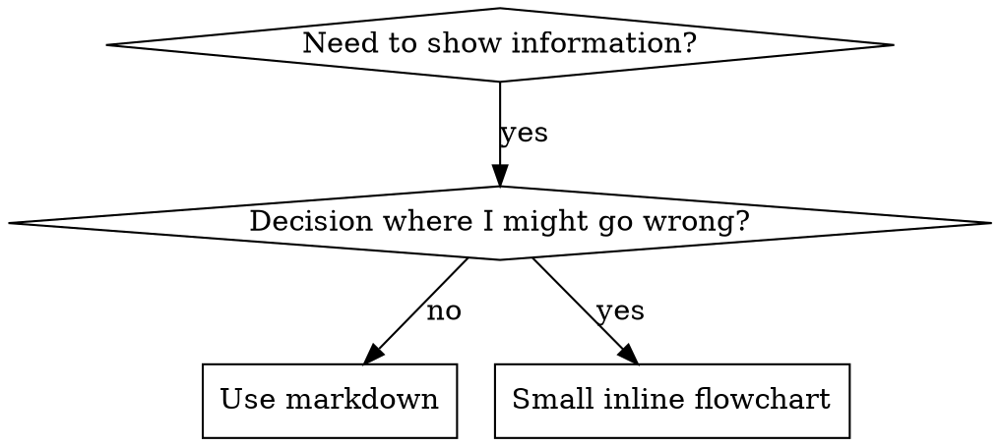

# 技能中的流程图

属于 superpowers:writing-skills。

## 流程图的用法



**只在以下情况使用流程图：**
- 不明显的决策点
- 你可能会过早停下的流程循环
- 「什么时候用 A、什么时候用 B」这类决策

**绝不要用流程图来表达：**
- 参考资料 → 表格、列表
- 代码示例 → Markdown 代码块
- 线性步骤 → 有序列表
- 没有语义的标签（step1、helper2）

graphviz 的样式规则见本目录下的 `graphviz-conventions.dot`。

**为你的搭档做可视化：**用 writing-skills 目录下的 `render-graphs.js` 把技能里的流程图渲染成 SVG，并在该目录下运行：
```bash
node ./render-graphs.js ../some-skill           # Each diagram separately
node ./render-graphs.js ../some-skill --combine # All diagrams in one SVG
```
